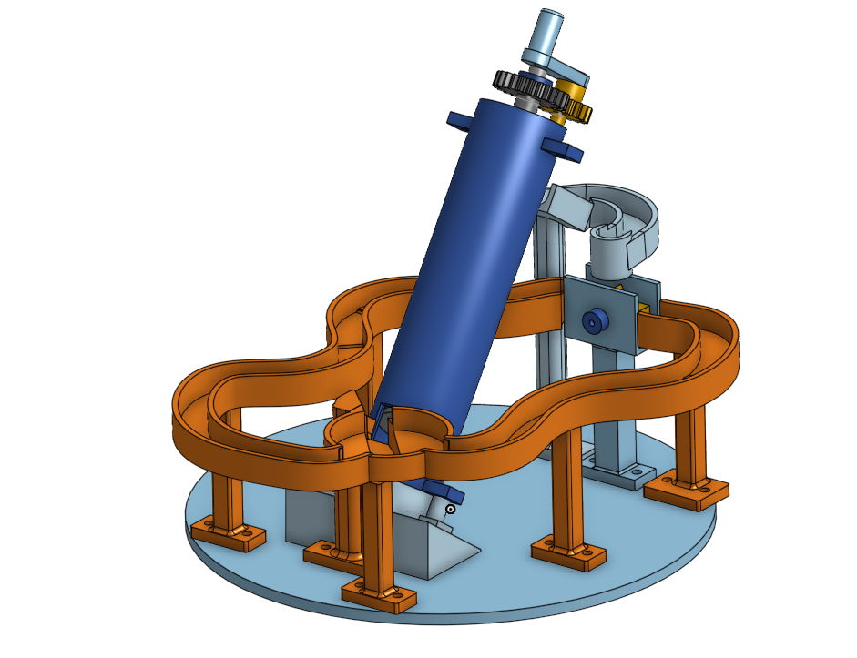
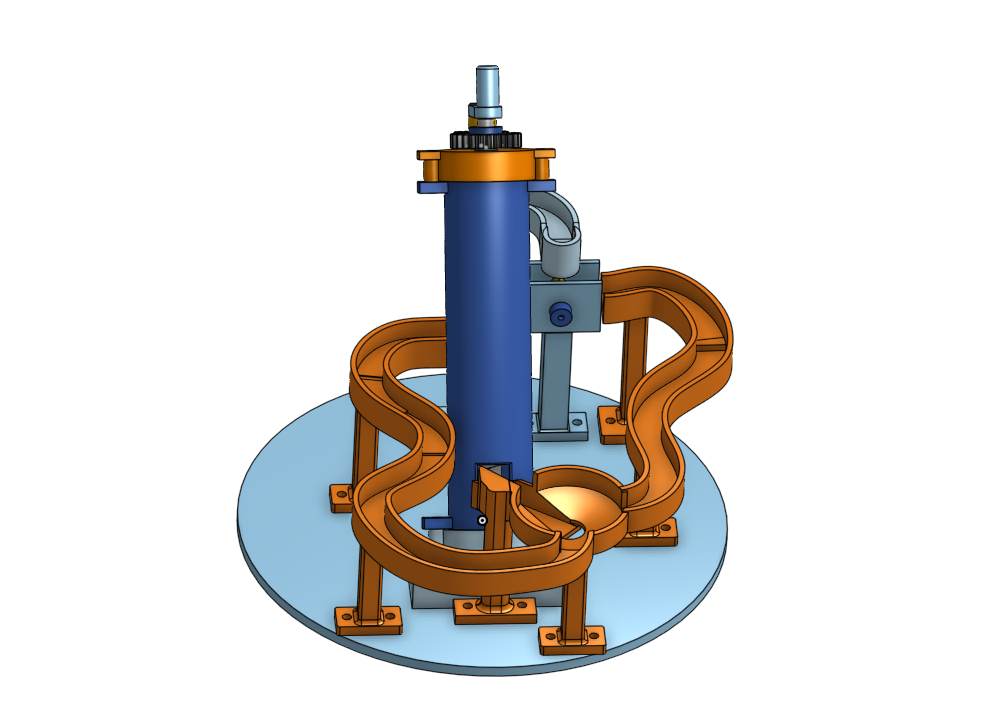
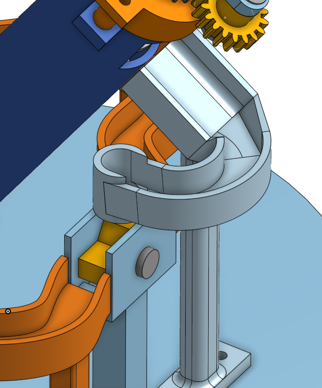
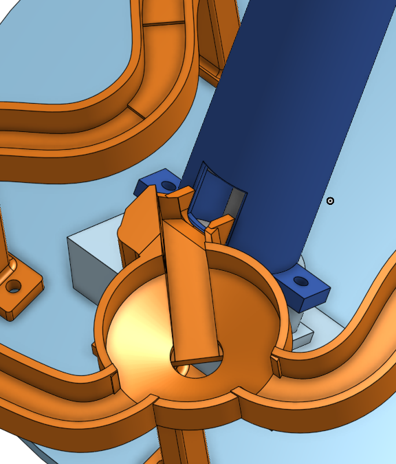
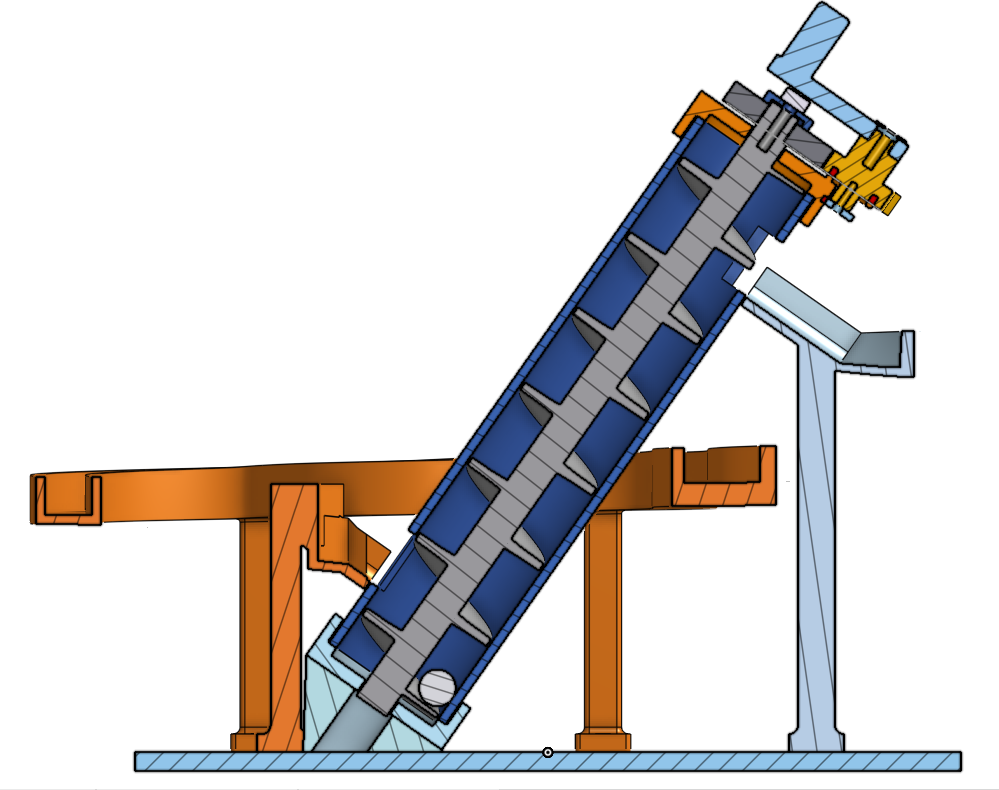

# Orbitrail

A hand-cranked marble run designed in Onshape for **Hack Club Half Life**. Orbitrail combines a screw elevator, a geared crank, a rocker, and two different gravity return tracks in one compact circuit.

**Status:** Complete CAD layout; printing, assembly, and physical testing are still pending.

## How it works

1. Marbles enter the inclined screw elevator through the inlet ramp.
2. Turning the hand crank drives the screw through an 18-tooth / 24-tooth gear pair.
3. The screw is intended to carry the marbles up to the outlet chute.
4. The outlet guides each marble toward the rocker, which is designed to direct marbles onto either return route.
5. One route follows a longer serpentine path with three small descending steps. The other includes a raised run-in, a small launch, and a wider receiving section.
6. Both routes reach a shared funnel and a tapered connection back to the original inlet ramp.

The crank supplies the energy for lifting; gravity powers the return tracks. Reliable lifting, rocker alternation, and the small jump still need to be confirmed with a physical prototype.

## Main features

- Inclined screw elevator with a separate housing and end caps.
- Geared hand crank with shaped shaft connections and retaining parts.
- Outlet chute and a transition into the supported rocker.
- Rocker pivot, retaining cap, frame, and its own mounting leg.
- Two distinct return routes with continuous curved channel surfaces.
- Shared funnel connected to the existing inlet.
- Mounting feet, fastener access, and rounded support junctions.

## Design gallery

### Return routes and supports

The two curved return routes wrap around the elevator and converge at the shared funnel. Separate mounting feet support the channels.

### Outlet and rocker

The outlet channel leads through the curved transition and drop guide toward the rocker. The rocker pivots inside a supported frame between the two return routes.

### Funnel and inlet connection

Both return routes feed the funnel. Its central outlet connects to the existing inlet ramp, which directs marbles back into the screw housing.

### Screw elevator section

This section exposes the screw flights inside the stationary housing and the shaft support arrangement. It is a geometry inspection view; marble motion has not yet been physically tested.

## Design specifications

| Feature | CAD design |
| --- | --- |
| Reference marble diameter | 8 mm |
| Circular base diameter | 180 mm |
| Screw flight length | 140 mm |
| Screw pitch | 20 mm |
| Screw outside diameter | 26 mm |
| Housing inside / outside diameter | 27 / 31 mm |
| Crank gear / screw gear | 18 / 24 teeth |
| Gear module / pressure angle | 1 / 20° |
| Gear center distance | 21 mm |
| Main mounting hardware | M3 fasteners |
| CAD platform | Onshape |

Some return-track sections extend beyond the circular base. Dimensions and clearances are nominal CAD values and may need adjustment after printing.

## Development and design decisions

The project began with the screw, housing, end supports, and gear drive. The next stage added the crank, shaft retention, pedestal, and inlet. The outlet, rocker, return routes, funnel, and additional supports completed the current layout.

Several revisions shaped the final design:

- **Outlet transition:** Early lofts twisted or produced self-intersecting bodies. The transition was revised to obtain usable geometry between the channel sections.
- **Intake metering concept:** A crank-linked mechanism for releasing one marble at a time was considered. Its proposed shaft interfered with the inlet path, so that mechanism was left out of this version. The inlet ramp remains part of the design.
- **Support placement:** The initial funnel support conflicted with the inlet support. The foot was repositioned to separate them.
- **Return tracks:** Short segmented-looking surfaces were replaced with smoother curved channels, and the routes were expanded beyond the base where needed.
- **Support finishing:** Fillets were added at support junctions and mounting-foot corners.

Read the [development journal](JOURNAL.md) for the recorded design sessions.

## Bill of materials

No funding was requested for this project. This list documents the materials needed for the planned build; it is not a request for reimbursement. Printing is planned at the university. The printer, filament brand and slicing settings have not been confirmed.

### Materials

| Item | Planned quantity | Purpose / specification | Supply and cost status |
| --- | --- | --- | --- |
| PLA filament | 500 g provisional material allowance | Print one of each of the 17 STL parts listed below. Match filament diameter to the university printer. | University printing planned; material availability and any charge to be confirmed. No funding requested. |
| M3 machine screws | Assorted lengths; exact count and lengths pending assembly review | Secure the housing/end supports and mounting feet and provide the gear-retainer fixing where required. | Purchase or use available hardware after reviewing each joint. No supplier or price selected. |
| M3 hex nuts | As required by the selected through-bolt joints; count pending | Retain bolts where the design provides suitable nut access or pockets. Do not assume every hole requires a nut. | Selection and fit to be confirmed. No funding requested. |
| M3 washers | As required; count pending | Use where suitable to distribute bolt load or protect printed surfaces. The reference washer in the CAD is not a printable part. | Optional per joint; do not count every hole as requiring a washer. |
| 8 mm marbles | At least 1 for initial testing | Reference marble diameter used by the elevator and channels. Add more only after testing circulation. | Supplier, pack quantity and cost not yet selected. |

The hardware rows are requirements, **not a finalized shopping list**. Do not substitute M2 hardware without checking or adapting the M3 mounting design. Final screw lengths depend on the actual joint stack, head seating, nut engagement and clearance to moving parts.

### Filament allowance and its limits

The combined CAD solid volume of the 17 printable parts is **270.816 cm³**. Assuming a PLA density of **1.24 g/cm³**, a completely solid model would contain approximately **335.8 g** of PLA, excluding supports, brims, purge and failed prints.

The density is a reference assumption, not a confirmed material property of the university's filament; see [Polymaker PLA technical data](https://polymaker.com/wp-content/tech-docs/PolyLite_PLA_PIS_EN_V1.1.pdf).

**500 g is a provisional stock allowance**, not a slicer prediction or guaranteed upper limit. Actual consumption depends on walls, infill, orientation, supports and reprints. A lower infill percentage does not reduce the entire model mass by that percentage because walls and surface layers remain. Replace this allowance with the university slicer's total before manufacturing.

### Printed parts — one of each

| Part | STL file |
| --- | --- |
| Base | [base.stl](cad/stl/base.stl) |
| Lift screw | [lift-screw.stl](cad/stl/lift-screw.stl) |
| Lift housing | [lift-housing.stl](cad/stl/lift-housing.stl) |
| Lower cap | [lower-cap.stl](cad/stl/lower-cap.stl) |
| Upper cap | [upper-cap.stl](cad/stl/upper-cap.stl) |
| Lower pedestal | [lower-pedestal.stl](cad/stl/lower-pedestal.stl) |
| Lift gear | [lift-gear.stl](cad/stl/lift-gear.stl) |
| Lift gear retainer | [lift-gear-retainer.stl](cad/stl/lift-gear-retainer.stl) |
| Crank gear — 18 teeth | [crank-gear-18t.stl](cad/stl/crank-gear-18t.stl) |
| Crank arm | [crank-arm.stl](cad/stl/crank-arm.stl) |
| Crank retainer | [crank-retainer.stl](cad/stl/crank-retainer.stl) |
| Rocker frame | [rocker-frame.stl](cad/stl/rocker-frame.stl) |
| Rocker | [rocker.stl](cad/stl/rocker.stl) |
| Rocker pin | [rocker-pin.stl](cad/stl/rocker-pin.stl) |
| Rocker pin cap | [rocker-pin-cap.stl](cad/stl/rocker-pin-cap.stl) |
| Drop guide | [drop-guide.stl](cad/stl/drop-guide.stl) |
| Connected return tracks, stairs, funnel and supports | [smooth-stairs-curves-funnel.stl](cad/stl/smooth-stairs-curves-funnel.stl) |

Read the [STL printing notes](cad/stl/README.md) before slicing. The reference marble, curves and hardware reference bodies are excluded from the printed inventory. No motor, electronics or bearings are specified in this hand-cranked version.

### Budget status

**Requested funding: $0.00.** This does not mean the materials have no value or that supplier costs have been verified. Final purchase totals, if any, remain pending the hardware selection and printing arrangements. [BOM.csv](BOM.csv) mirrors the material requirements with unquoted prices left blank.

A standalone copy is available in [BOM.md](BOM.md).

## CAD and fabrication files

[Open the Onshape document](https://cad.onshape.com/documents/9d7366e6ecd3c485dafbc508/w/f743539e3379975558bc69c6/e/57d9ba763c1f60c505f6e92c)

[Download the complete STEP model](cad/Orbitrail.step). Import it into a CAD application with millimeter units to inspect the solids. A STEP export contains geometry; it does not preserve the original Onshape feature history or provide a motion simulation.

Download the **[17 individual STL files](cad/stl/)** and read the **[printing notes and part list](cad/stl/README.md)**. The meshes use millimeter dimensions and are centered separately for slicing. Select print orientations and review supports, tolerances, and assembly access before printing. The return tracks and funnel are one connected source solid and are exported together. Reference marbles, curves, and hardware-clearance bodies are excluded. These exports have passed geometry checks but have not been sliced or physically tested.

| Repository file | Purpose |
| --- | --- |
| [cad/Orbitrail.step](cad/Orbitrail.step) | Complete CAD geometry export |
| [cad/stl/](cad/stl/) | 17 individual STL parts with printing notes and mesh checks |
| [README.md](README.md) | Project overview and current status |
| [JOURNAL.md](JOURNAL.md) | Development journal mirrored from Half Life |
| [BOM.md](BOM.md) | Materials, 17-part printed inventory, PLA allowance and funding status |
| [BOM.csv](BOM.csv) | Material requirements; final hardware selection and supplier costs pending |
| [images/orbitrail-final.png](images/orbitrail-final.png) | Final CAD overview |

## Onshape Link:
https://cad.onshape.com/documents/9d7366e6ecd3c485dafbc508/w/f743539e3379975558bc69c6/e/57d9ba763c1f60c505f6e92c?renderMode=0&uiState=6adecd6f78c8b1e25694aa41

## Validation and next steps

CAD checks included solid validity, STEP export/reimport, sampled marble clearances in the return system, and rocker-to-return-module clearance at selected angles. These are static geometry checks and do not establish reliable marble motion.

Before calling the mechanism physically validated:

- Print and check the screw-to-housing fit and gear engagement.
- Assemble the shaft retainers and confirm free rotation.
- Test lifting and the outlet transfer with 8 mm marbles.
- Check rocker switching and both return routes.
- Test the launch and receiving section, funnel exit, and inlet transition.
- Adjust tolerances and complete the hardware list from the assembled prototype.

## Project

Created by **Nash Andrés Rivera Ramírez** for [Hack Club Half Life](https://halflife.hackclub.com/projects/cmv4qoh3u0f0t01n0i6g0c1up).
